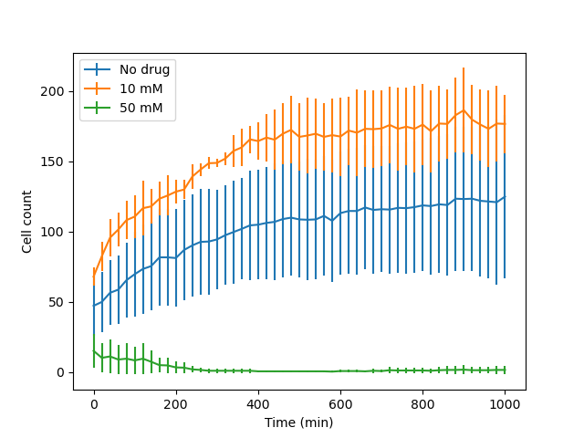

# Experimental Time-Series Data Visualization Using Python and Matplotlib

**Coursework Project | University of Pittsburgh**

## Project Overview

This project was completed as part of my coursework at the University of Pittsburgh. It involved developing Python scripts to visualize experimental time-series data, focusing on changes in cell counts over time under different experimental conditions.

The project progressively introduced data parsing, single- and multi-dataset visualization, command-line argument handling, and statistical summaries of replicate measurements.

Using Matplotlib and NumPy, the scripts generate line plots and error-bar visualizations to compare experimental conditions and examine variability across replicates.

## Objectives

- Read and process experimental data from text files.
- Generate time-series line plots using Python and Matplotlib.
- Add axis labels and legends for clear data interpretation.
- Compare multiple experimental conditions in a single visualization.
- Process replicate measurements at each time point.
- Calculate mean and standard deviation using NumPy.
- Generate and save plots through command-line execution.

## Tools and Technologies

| Tool | Purpose |
|------|---------|
| Python | Data processing and scripting |
| Matplotlib | Line plots and error-bar visualization |
| NumPy | Mean and standard deviation calculations |
| sys | Command-line argument handling |
| File I/O | Reading and parsing experimental data |

## Analysis Workflow

```text
Experimental Time-Series Data
            |
            v
     Read Input Files
            |
            v
   Parse Time and Cell Counts
            |
            v
   Identify Experimental Conditions
            |
            v
   Process Replicate Measurements
            |
            v
 Calculate Mean and Standard Deviation
            |
            v
 Generate Line Plots / Error Bars
            |
            v
       Save PNG Output
```

## Implementation

The project consists of five Python scripts, each demonstrating different levels of visualization functionality.

| Script | Functionality |
|--------|---------------|
| `assign-50.py` | Generates a basic line plot from a single dataset |
| `assign-20.py` | Adds axis labels and a legend |
| `assign-10.py` | Plots multiple datasets with condition-specific legends |
| `assign-15.py` | Accepts multiple input files through command-line arguments |
| `assign-05.py` | Calculates replicate means and standard deviations and generates error-bar plots |

### 1. Single-Dataset Visualization

- Read comma-separated experimental measurements.
- Extracted time and cell-count values.
- Generated basic line plots using Matplotlib.
- Saved visualizations as PNG files.

### 2. Multiple Experimental Conditions

- Extended plotting scripts to accept multiple input files.
- Used the first line of each file as the experimental condition label.
- Plotted multiple conditions on the same axes.
- Added legends to distinguish datasets.

### 3. Replicate Analysis and Error Bars

- Processed multiple replicate measurements for each time point.
- Calculated mean cell counts using `numpy.mean()`.
- Calculated standard deviation using `numpy.std()`.
- Generated error-bar plots to visualize variation among replicates.

## Input Data Format

### Single Measurement per Time Point

```text
No drug
0,72
20,71
40,77
```

The first line represents the experimental condition. Each subsequent row contains a time point and its corresponding cell count.

### Multiple Replicates per Time Point

```text
No drug
0,72,39,16,62
20,71,45,17,67
40,77,51,21,77
```

The first value in each row represents time, followed by replicate cell-count measurements.

## Usage

### Install Dependencies

```bash
pip install matplotlib numpy
```

### Basic Line Plot

```bash
python assign-50.py in.0 output.png
```

### Multiple Experimental Conditions

```bash
python assign-15.py in.0 in.1 in.2 output.png
```

### Mean and Standard Deviation Visualization

```bash
python assign-05.py mc.0 mc.1 mc.2 output.png
```

The scripts use Matplotlib's `Agg` backend to generate plots without requiring a graphical display.

## Example Outputs

The repository includes example PNG outputs illustrating the different visualization stages.

| File | Description |
|------|-------------|
| `outex.50.png` | Basic time-series line plot |
| `outex.20.png` | Line plot with labels and legend |
| `outex.15.png` | Multi-condition visualization |
| `outex.10.png` | Multi-dataset line plot |
| `outex.05.png` | Mean trends with standard deviation error bars |

### Example: Replicate Measurements with Error Bars



## Repository Contents

**Python Scripts**
- `assign-50.py`
- `assign-20.py`
- `assign-10.py`
- `assign-15.py`
- `assign-05.py`

**Input Data**
- `in.0`, `in.1`, `in.2` — Single-measurement time-series datasets.
- `mc.0`, `mc.1`, `mc.2` — Datasets containing replicate measurements.

**Outputs**
- `outex.50.png`
- `outex.20.png`
- `outex.15.png`
- `outex.10.png`
- `outex.05.png`

## Limitations

- Input files must follow the expected comma-separated format.
- The scripts demonstrate basic scientific visualization rather than a general-purpose data analysis package.
- Error bars represent standard deviation across replicate measurements, calculated using NumPy's default population standard deviation.
- Statistical hypothesis testing and automated data quality assessment are not included.

## Skills Demonstrated

- Python programming and scripting
- Scientific visualization using Matplotlib
- Experimental time-series data processing
- Command-line interface development
- Data parsing and file handling
- Descriptive statistical analysis using NumPy
- Visualization of replicate variability
- Automated plot generation

## Coursework Acknowledgment

This project was completed as part of coursework at the **University of Pittsburgh** and demonstrates foundational Python programming, data processing, and scientific visualization techniques.

## Author

**Lakshita Arunkumar**

University of Pittsburgh

[GitHub Profile](https://github.com/LakshitaArunkumar)
